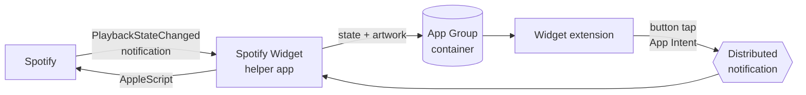

<div align="center">

# Spotify Widget

**A native macOS desktop widget for the Spotify app.**
Album art, live progress, playback controls — right on your desktop and in Notification Center.

[](#changelog)
[](#requirements)
[](#requirements)
[](#requirements)
[](#languages)
[](LICENSE)

**English** · [Türkçe](README.tr.md)


</div>

<!--
Demo recording goes here once it's added:
<p align="center"></p>
-->

## Features

|  |  |
|---|---|
| 🎨 **Native look** | Blurred album-art background, system fonts and materials, light & dark mode |
| 📐 **Three sizes** | Small, medium and large — drag them anywhere on the desktop or into Notification Center |
| ⏯️ **Controls** | Play / pause, previous and next track straight from the widget |
| ⏱️ **Live progress** | Progress bar with elapsed and total time that moves while the song plays |
| 🎯 **Seek** | Click anywhere on the progress bar to jump to that point |
| 🌍 **16 languages** | Follows your Mac's language automatically |
| ⚡ **Lightweight** | ~0% CPU when idle, ~26 MB of memory, no polling |
| 🔒 **Private** | Everything stays on your Mac — no accounts, no analytics, no Spotify API keys |

## Requirements

| | Minimum | Tested on |
|---|---|---|
| **macOS** | 14 Sonoma (interactive widgets) | macOS 27.2 |
| **Xcode** | 16 (folder-synced project format) | Xcode 27.2 |
| **Spotify** | Desktop app — the web player is not supported | 1.3.6 |
| **Apple ID** | Free account signed in to Xcode | — |

Apple Silicon and Intel Macs are both supported.

## Installation

> There's no prebuilt download yet. Apps signed with a free Apple ID can't be notarized, so you build it yourself — it takes about two minutes.

**1. Clone**

```sh
git clone https://github.com/<your-username>/SpotifyWidget.git
cd SpotifyWidget
```

**2. Add your signing details**

```sh
cp Configs/Local.xcconfig.example Configs/Local.xcconfig
```

Open `Configs/Local.xcconfig` and fill in:

| Key | Where to find it |
|---|---|
| `DEVELOPMENT_TEAM` | Xcode → Settings → Accounts → select your team → *Team ID* |
| `BUNDLE_ID_PREFIX` | Anything unique, e.g. `com.yourname` |

**3. Build**

```sh
xcodebuild -project SpotifyWidget.xcodeproj -scheme SpotifyWidget \
  -configuration Release -derivedDataPath build -allowProvisioningUpdates build
```

Or open `SpotifyWidget.xcodeproj` in Xcode and press **⌘B** with the *Release* configuration.

**4. Install and launch**

```sh
mkdir -p ~/Applications
cp -R "build/Build/Products/Release/Spotify Widget.app" ~/Applications/
open ~/Applications/"Spotify Widget.app"
```

The app has no window — it runs quietly in the background and adds itself to your login items.

**5. Allow access**

When macOS asks whether *Spotify Widget* may control *Spotify*, click **Allow**.

**6. Add the widget**

Right-click the desktop → **Edit Widgets** → search for **Spotify** → drag the size you want onto the desktop.

## How it works

Widgets run in a sandbox and can't talk to other apps, so the project is split in two:



- **Helper app** (`SpotifyWidget/`) listens to Spotify's `com.spotify.client.PlaybackStateChanged` notification. Track info comes straight from the notification payload; AppleScript is only used for artwork URLs and playback commands. Artwork is downloaded once per track, cached, and a small blurred background is pre-rendered so the widget never has to blur anything itself.
- **Widget extension** (`SpotifyWidgetExtension/`) reads the shared state and renders it. The progress bar is driven by precomputed timeline entries, so it moves without waking anything up. Buttons are App Intents that post a distributed notification back to the helper.

### Performance

Measured on an Apple Silicon Mac with the Release build:

| Action | Time |
|---|---|
| Reading Spotify's state | 1–12 ms |
| Play / pause | ~21 ms |
| Next track, including artwork download | ~110 ms |
| Idle CPU | 0% |
| Memory (helper) | ~26 MB |

## Languages

The widget follows your Mac's language (System Settings → General → Language & Region).

| | | | |
|---|---|---|---|
| 🇬🇧 English | 🇹🇷 Türkçe | 🇦🇿 Azərbaycanca | 🇰🇿 Қазақша |
| 🇰🇬 Кыргызча | 🇺🇿 Oʻzbekcha | 🇹🇲 Türkmençe | 🇩🇪 Deutsch |
| 🇪🇸 Español | 🇫🇷 Français | 🇮🇹 Italiano | 🇧🇷 Português (Brasil) |
| 🇷🇺 Русский | 🇯🇵 日本語 | 🇰🇷 한국어 | 🇨🇳 简体中文 |

Translations live in [`SpotifyWidgetExtension/Localizable.xcstrings`](SpotifyWidgetExtension/Localizable.xcstrings) and [`SpotifyWidget/InfoPlist.xcstrings`](SpotifyWidget/InfoPlist.xcstrings). Corrections and new languages are very welcome.

## Project structure

```
SpotifyWidget/
├── Configs/                    Build settings (.xcconfig)
│   ├── Base.xcconfig           Shared settings, version, Debug/Release
│   ├── SpotifyWidget.xcconfig
│   ├── SpotifyWidgetExtension.xcconfig
│   ├── SpotifyWidgetTests.xcconfig
│   └── Local.xcconfig.example  Your team ID and bundle prefix
├── Shared/                     Code used by both targets
├── SpotifyWidget/              Background helper app
├── SpotifyWidgetExtension/     WidgetKit extension
│   └── Views/
├── Tests/                      Unit tests (Swift Testing)
└── docs/images/                README images
```

## Tests

```sh
xcodebuild test -project SpotifyWidget.xcodeproj -scheme SpotifyWidgetTests -destination 'platform=macOS'
```

## Troubleshooting

<details>
<summary><b>The widget doesn't show up in the gallery</b></summary>

Make sure the app is running (`pgrep -l "Spotify Widget"`) and launched from `~/Applications` or `/Applications`. If the gallery still shows an old name or icon, log out and back in — the widget gallery caches app info.
</details>

<details>
<summary><b>The widget says nothing is playing</b></summary>

Start playback in the Spotify desktop app. If it still doesn't update, check System Settings → Privacy & Security → Automation and make sure *Spotify Widget* is allowed to control *Spotify*.
</details>

<details>
<summary><b>I clicked "Don't Allow" on the permission prompt</b></summary>

Reset the permission and relaunch the app:

```sh
tccutil reset AppleEvents <your-bundle-prefix>.spotifyhelper
```
</details>

<details>
<summary><b>The widget looks grey / without artwork</b></summary>

macOS dims desktop widgets while an app window is in front of them. Click an empty part of the desktop and the full-colour version comes back.
</details>

## Custom icon

Put an `Assets.car` (compiled icon with an `AppIcon` entry) and/or an `AppIcon.icns` in `SpotifyWidget/`, and they'll be picked up automatically. Both are git-ignored.

## Changelog

**1.1**
- Track info read directly from Spotify's notifications — up to 10× faster updates
- Click-to-seek progress bar with elapsed and total time
- 16 languages, including Azerbaijani, Kazakh, Kyrgyz, Uzbek and Turkmen
- Uncropped square artwork in the large size
- Unit tests

**1.0**
- First release

## Disclaimer

This project is not affiliated with, endorsed by, or sponsored by Spotify. Spotify is a trademark of Spotify AB.

## License

[MIT](LICENSE)
