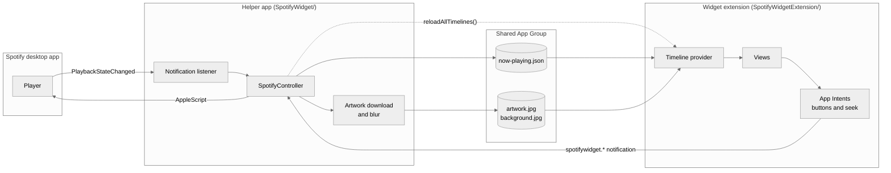
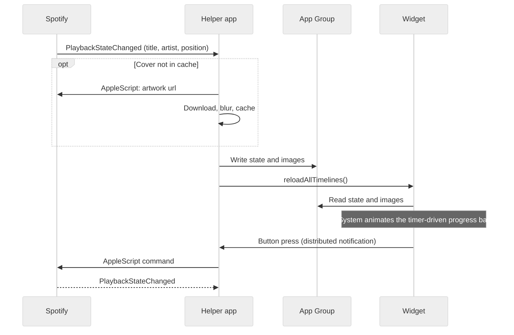

<div align="center">

# Spotify Widget

A native macOS widget for the Spotify desktop app. It shows album art, live progress<br>
and playback controls on your desktop and in Notification Center.

[](#installation)
[](#requirements)
[](#languages)
[](LICENSE)

**English** · [Türkçe](README.tr.md)


<sub><a href="docs/demo.mp4">Watch in full quality</a></sub>

</div>

## Features

The widget comes in small, medium and large sizes and works on the desktop and in Notification Center. You can play, pause and skip tracks without switching to Spotify, and clicking the progress bar jumps to that point in the song. The bar and the elapsed time keep moving while music plays.

Album art is shown uncropped over a blurred copy of itself, with system fonts, so it sits next to Apple's own widgets without looking out of place. Text follows your Mac's language; 16 languages are included.

The helper app does nothing until Spotify reports a change, so it uses no CPU while idle. The only network traffic is artwork requests to Spotify's image servers. There are no accounts, analytics or API keys.

## Requirements

| | Minimum | Tested with |
|---|---|---|
| macOS | 14 Sonoma | 27.2 |
| Xcode (to build) | 16 | 27.2 |
| Spotify | Desktop app | 1.3.6 |

The Spotify web player is not supported; the widget only talks to the desktop app. Builds are universal (Apple silicon and Intel), but they have only been tested on Apple silicon.

## Installation

You build the app from source once. It takes about two minutes, and you need Xcode and a free Apple ID. If `xcodebuild` says it requires Xcode, run `sudo xcode-select -s /Applications/Xcode.app` first.

### 1. Clone the repository

```sh
git clone https://github.com/Daenqs/SpotifyWidget.git
cd SpotifyWidget
```

### 2. Add your signing details

Sign in to Xcode with your Apple ID (Xcode → Settings → Accounts). Then create your local config:

```sh
cp Configs/Local.xcconfig.example Configs/Local.xcconfig
```

Open `Configs/Local.xcconfig` and set both values:

| Key | Value |
|---|---|
| `DEVELOPMENT_TEAM` | Your Team ID. Xcode → Settings → Accounts → select your team. |
| `BUNDLE_ID_PREFIX` | Anything unique to you, e.g. `com.yourname` |

`Local.xcconfig` is git-ignored, so your details stay out of commits.

### 3. Build

```sh
xcodebuild -project SpotifyWidget.xcodeproj -scheme SpotifyWidget \
  -configuration Release -destination 'generic/platform=macOS' \
  -derivedDataPath build -allowProvisioningUpdates build
```

### 4. Install and launch

```sh
mkdir -p ~/Applications
cp -R "build/Build/Products/Release/Spotify Widget.app" ~/Applications/
open ~/Applications/"Spotify Widget.app"
```

The app has no window or Dock icon. It runs in the background and starts automatically when you log in.

### 5. Allow access

macOS asks whether *Spotify Widget* may control *Spotify*. Click Allow.

### 6. Add the widget

Right-click the desktop, choose Edit Widgets, search for Spotify and drag a size onto the desktop.

## Uninstall

1. Remove the widget from the desktop.
2. Quit the helper and delete the app:
   ```sh
   pkill -x "Spotify Widget"
   rm -rf /Applications/"Spotify Widget.app" ~/Applications/"Spotify Widget.app"
   ```
3. Remove *Spotify Widget* from System Settings → General → Login Items, if it is still listed.

## How it works

A widget runs in a sandbox and can't control other apps, so the project has two parts: a small helper app that talks to Spotify, and the widget itself. They share data through an App Group container.



The same flow, in the order things happen when a song changes and when you press a button:



The helper (`SpotifyWidget/`) listens for Spotify's `com.spotify.client.PlaybackStateChanged` notification and reads the track info straight from it. AppleScript is used only for playback commands and to fetch the artwork URL when the track changes. When the track changes, the new title is drawn right away and the cover follows when it has downloaded. Each cover is downloaded once and cached, and the helper renders a small blurred background from it so the widget never has to blur anything. If a download fails, for example because the network isn't up yet after login, the track is shown without artwork and the download is retried once. The helper also opts out of App Nap, which otherwise held updates back for over a minute after login.

The widget extension (`SpotifyWidgetExtension/`) reads the shared state and draws it. The progress bar is a timer-driven `ProgressView` that the system animates by itself, so each change produces a single timeline entry and the widget redraws in about 100 ms. The buttons are App Intents that send a notification back to the helper.

### Performance

Release build on an Apple silicon Mac:

| | |
|---|---|
| Reading Spotify's state | 1–12 ms |
| Play / pause | about 20 ms |
| Next track, title on screen | about 100 ms |
| Next track, new cover on screen | about 150–300 ms |
| Widget redraw after a change | about 100 ms |
| CPU when idle | 0% |
| Memory (helper app) | about 26 MB |

## Languages

The widget uses your Mac's language from System Settings → General → Language & Region. If your language is not listed, the widget uses English.

| | | | |
|---|---|---|---|
| English | Türkçe | Azərbaycanca | Қазақша |
| Кыргызча | Oʻzbekcha | Türkmençe | Deutsch |
| Español | Français | Italiano | Português (Brasil) |
| Русский | 日本語 | 한국어 | 简体中文 |

Translations live in [`SpotifyWidgetExtension/Localizable.xcstrings`](SpotifyWidgetExtension/Localizable.xcstrings) and [`SpotifyWidget/InfoPlist.xcstrings`](SpotifyWidget/InfoPlist.xcstrings). Corrections and new languages are welcome as pull requests.

## Project structure

```
Configs/                  Build settings
  Base.xcconfig           Version and shared settings
  Local.xcconfig.example  Template for your Team ID and bundle prefix
Shared/                   Code used by the helper and the widget
SpotifyWidget/            Helper app
SpotifyWidgetExtension/   Widget extension
Tests/                    Unit tests
docs/                     Demo video and GIF
```

## Development

Run the tests:

```sh
xcodebuild test -project SpotifyWidget.xcodeproj -scheme SpotifyWidgetTests -destination 'platform=macOS'
```

Watch the helper's timing logs while using the widget:

```sh
log stream --level debug --predicate 'subsystem == "spotifywidget"'
```

To use your own app icon, put an `AppIcon.icns` and/or a compiled `Assets.car` with an `AppIcon` entry in `SpotifyWidget/`. Both files are git-ignored.

## Troubleshooting

<details>
<summary>The widget does not appear in the widget gallery</summary>

Check that the helper is running with `pgrep -l "Spotify Widget"` and that the app is in `~/Applications` or `/Applications`. The gallery caches app names and icons, so if it shows an old one, log out and back in.
</details>

<details>
<summary>The widget says nothing is playing</summary>

Start a song in the Spotify desktop app. If the widget still does not update, open System Settings → Privacy & Security → Automation and check that *Spotify Widget* may control *Spotify*.
</details>

<details>
<summary>I clicked "Don't Allow" on the permission prompt</summary>

Reset the permission, then open the app again:

```sh
tccutil reset AppleEvents "$(osascript -e 'id of app "Spotify Widget"')"
open -a "Spotify Widget"
```
</details>

<details>
<summary>The widget turns grey</summary>

macOS dims desktop widgets while a window is in front of them. Click an empty part of the desktop to bring the colours back.
</details>

## License

[MIT](LICENSE)
