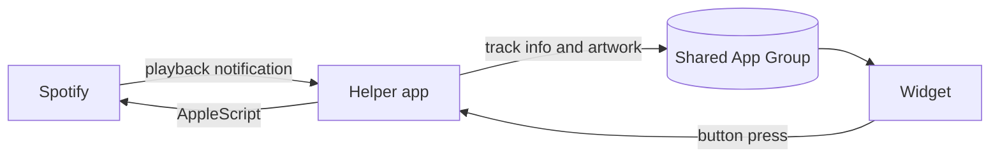

<div align="center">

# Spotify Widget

A native macOS widget for the Spotify desktop app.<br>
Album art, live progress and playback controls on your desktop and in Notification Center.

[](#changelog)
[](#requirements)
[](#languages)
[](LICENSE)

**English** · [Türkçe](README.tr.md)


</div>

<!--
Demo recording:
<p align="center"></p>
-->

## Features

- **Three sizes.** Small, medium and large, on the desktop or in Notification Center.
- **Playback controls.** Play, pause, previous and next without switching to Spotify.
- **Live progress.** The bar and elapsed time move while the song plays.
- **Click to seek.** Click anywhere on the progress bar to jump there.
- **Feels native.** Blurred album-art background and system fonts. Album art is never cropped.
- **16 languages.** Follows your Mac's language automatically.
- **Lightweight.** No polling. It only does work when Spotify reports a change.
- **Private.** Nothing leaves your Mac except artwork requests to Spotify's image servers. No accounts, analytics or API keys.

## Requirements

| | Minimum | Tested with |
|---|---|---|
| macOS | 14 Sonoma | 27.2 |
| Xcode (to build) | 16 | 27.2 |
| Spotify | Desktop app | 1.3.6 |

- The Spotify **web player is not supported**. The widget talks to the desktop app.
- Builds are universal (Apple silicon and Intel). It has only been tested on Apple silicon.

## Installation

There is no prebuilt download yet, so you need to build the app once. It takes about two minutes and only needs a free Apple ID.

### 1. Clone the repository

```sh
git clone https://github.com/<your-username>/SpotifyWidget.git
cd SpotifyWidget
```

### 2. Add your signing details

Sign in to Xcode with your Apple ID (Xcode → Settings → Accounts). Then create your local config:

```sh
cp Configs/Local.xcconfig.example Configs/Local.xcconfig
```

Open `Configs/Local.xcconfig` and set both values:

| Key | Value |
|---|---|
| `DEVELOPMENT_TEAM` | Your Team ID. Xcode → Settings → Accounts → select your team. |
| `BUNDLE_ID_PREFIX` | Anything unique to you, e.g. `com.yourname` |

`Local.xcconfig` is git-ignored, so your details never end up in a commit.

### 3. Build

```sh
xcodebuild -project SpotifyWidget.xcodeproj -scheme SpotifyWidget \
  -configuration Release -destination 'generic/platform=macOS' \
  -derivedDataPath build -allowProvisioningUpdates build
```

### 4. Install and launch

```sh
mkdir -p ~/Applications
cp -R "build/Build/Products/Release/Spotify Widget.app" ~/Applications/
open ~/Applications/"Spotify Widget.app"
```

The app has no window or Dock icon. It runs in the background and adds itself to your login items.

### 5. Allow access

macOS asks whether *Spotify Widget* may control *Spotify*. Click **Allow**.

### 6. Add the widget

Right-click the desktop and choose **Edit Widgets**. Search for **Spotify** and drag a size onto the desktop.

## Uninstall

1. Remove the widget from the desktop.
2. Quit the helper and delete the app:
   ```sh
   pkill -x "Spotify Widget"
   rm -rf ~/Applications/"Spotify Widget.app"
   ```
3. Remove *Spotify Widget* from System Settings → General → Login Items, if it is still listed.

## How it works

Widgets run in a sandbox and cannot control other apps. The project therefore has two parts.



**Helper app** (`SpotifyWidget/`)
- Listens to Spotify's `com.spotify.client.PlaybackStateChanged` notification. Track info is read straight from the notification.
- Uses AppleScript only for playback commands and for the artwork URL when the track changes.
- Downloads each cover once, caches it, and pre-renders a small blurred background so the widget never has to blur anything.

**Widget extension** (`SpotifyWidgetExtension/`)
- Reads the shared state and draws it.
- The progress bar moves through precomputed timeline entries, which do not count against the widget refresh budget.
- Buttons are App Intents that send a message back to the helper.

### Performance

Release build on an Apple silicon Mac:

| | |
|---|---|
| Reading Spotify's state | 1–12 ms |
| Play / pause | about 20 ms |
| Next track, including artwork download | about 110 ms |
| CPU when idle | 0% |
| Memory (helper app) | about 26 MB |

## Languages

The widget uses your Mac's language from System Settings → General → Language & Region. If your language is not listed, the widget uses English.

| | | | |
|---|---|---|---|
| English | Türkçe | Azərbaycanca | Қазақша |
| Кыргызча | Oʻzbekcha | Türkmençe | Deutsch |
| Español | Français | Italiano | Português (Brasil) |
| Русский | 日本語 | 한국어 | 简体中文 |

Translations live in [`SpotifyWidgetExtension/Localizable.xcstrings`](SpotifyWidgetExtension/Localizable.xcstrings) and [`SpotifyWidget/InfoPlist.xcstrings`](SpotifyWidget/InfoPlist.xcstrings). Corrections and new languages are welcome.

## Project structure

```
Configs/                  Build settings
  Base.xcconfig           Version and shared settings
  Local.xcconfig.example  Template for your Team ID and bundle prefix
Shared/                   Code used by the helper and the widget
SpotifyWidget/            Helper app
SpotifyWidgetExtension/   Widget extension
Tests/                    Unit tests
docs/images/              README images
```

## Development

Run the tests:

```sh
xcodebuild test -project SpotifyWidget.xcodeproj -scheme SpotifyWidgetTests -destination 'platform=macOS'
```

Watch the helper's timing logs while using the widget:

```sh
log stream --level debug --predicate 'subsystem == "spotifywidget"'
```

To use your own app icon, put an `AppIcon.icns` and/or a compiled `Assets.car` with an `AppIcon` entry in `SpotifyWidget/`. Both files are git-ignored.

## Troubleshooting

<details>
<summary>The widget does not appear in the widget gallery</summary>

Check that the helper is running with `pgrep -l "Spotify Widget"` and that the app is in `~/Applications` or `/Applications`. If the gallery shows an old name or icon, log out and back in. The gallery caches app details.
</details>

<details>
<summary>The widget says nothing is playing</summary>

Start a song in the Spotify desktop app. If the widget still does not update, open System Settings → Privacy & Security → Automation and check that *Spotify Widget* may control *Spotify*.
</details>

<details>
<summary>I clicked "Don't Allow" on the permission prompt</summary>

Reset the permission, then open the app again:

```sh
tccutil reset AppleEvents <your-bundle-prefix>.spotifyhelper
open ~/Applications/"Spotify Widget.app"
```
</details>

<details>
<summary>The widget turns grey</summary>

macOS dims desktop widgets while a window is in front of them. Click an empty part of the desktop and the colours come back.
</details>

## Changelog

### 1.1
- Track info is read directly from Spotify's notifications, so updates are much faster.
- Progress bar with elapsed and total time. Click it to seek.
- 16 languages, including Azerbaijani, Kazakh, Kyrgyz, Uzbek and Turkmen.
- Album art is shown uncropped in the large size.
- Unit tests.

### 1.0
- First release.

## Disclaimer

This project is not affiliated with, endorsed by or sponsored by Spotify. Spotify is a trademark of Spotify AB.

## License

[MIT](LICENSE)
