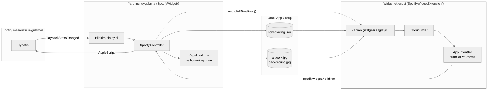
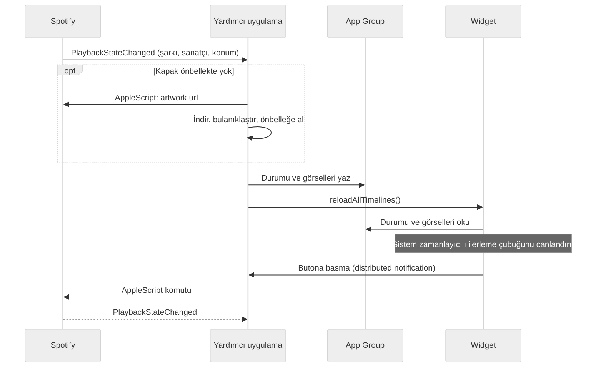

<div align="center">

# Spotify Widget

Spotify masaüstü uygulaması için yerel bir macOS widget'ı. Albüm kapağını, canlı ilerlemeyi<br>
ve oynatma kontrollerini masaüstüne ve Bildirim Merkezi'ne getirir.

[](#kurulum)
[](#gereksinimler)
[](#diller)
[](LICENSE)

[English](README.md) · **Türkçe**


<sub><a href="docs/demo.mp4">Yüksek kalitede izle</a></sub>

</div>

## Özellikler

Widget küçük, orta ve büyük boyutta gelir; masaüstünde de Bildirim Merkezi'nde de çalışır. Spotify'a geçmeden şarkıyı oynatıp duraklatabilir, ileri geri atlayabilirsin. İlerleme çubuğunda bir yere tıklarsan şarkı oraya atlar. Müzik çalarken çubuk ve geçen süre ilerlemeye devam eder.

Albüm kapağı kırpılmadan, kendi bulanık kopyasının üstünde ve sistem yazı tipleriyle görünür. Böylece Apple'ın kendi widget'larının yanında sırıtmaz. Yazılar Mac'inin dilini izler; 16 dil hazır gelir.

Yardımcı uygulama Spotify bir değişiklik bildirene kadar hiçbir şey yapmaz, boştayken işlemci kullanmaz. Dışarı giden tek trafik Spotify'ın görsel sunucularına giden kapak istekleridir. Hesap, analiz ya da API anahtarı yok.

## Gereksinimler

| | En düşük | Test edilen |
|---|---|---|
| macOS | 14 Sonoma | 27.2 |
| Xcode (derlemek için) | 16 | 27.2 |
| Spotify | Masaüstü uygulaması | 1.3.6 |

Spotify web oynatıcısı desteklenmez; widget yalnızca masaüstü uygulamasıyla konuşur. Derlenen uygulama universal'dır (Apple silicon ve Intel), ama yalnızca Apple silicon'da test edildi.

## Kurulum

Uygulamayı kaynak koddan bir kez derlemen yeterli. Yaklaşık iki dakika sürüyor; Xcode ve ücretsiz bir Apple ID lazım. `xcodebuild` Xcode gerektiğini söylerse önce `sudo xcode-select -s /Applications/Xcode.app` komutunu çalıştır.

### 1. Depoyu indir

```sh
git clone https://github.com/Daenqs/SpotifyWidget.git
cd SpotifyWidget
```

### 2. İmza bilgilerini ekle

Xcode'da Apple ID ile oturum aç (Xcode → Settings → Accounts). Sonra yerel ayar dosyasını oluştur:

```sh
cp Configs/Local.xcconfig.example Configs/Local.xcconfig
```

`Configs/Local.xcconfig` dosyasını açıp iki değeri de doldur:

| Anahtar | Değer |
|---|---|
| `DEVELOPMENT_TEAM` | Team ID'n. Xcode → Settings → Accounts → takımını seç. |
| `BUNDLE_ID_PREFIX` | Sana özgü herhangi bir şey, ör. `com.adin` |

`Local.xcconfig` git'e eklenmediği için bilgilerin commit'lere girmez.

### 3. Derle

```sh
xcodebuild -project SpotifyWidget.xcodeproj -scheme SpotifyWidget \
  -configuration Release -destination 'generic/platform=macOS' \
  -derivedDataPath build -allowProvisioningUpdates build
```

### 4. Kur ve başlat

```sh
mkdir -p ~/Applications
cp -R "build/Build/Products/Release/Spotify Widget.app" ~/Applications/
open ~/Applications/"Spotify Widget.app"
```

Uygulamanın penceresi ve Dock simgesi yok. Arka planda çalışır ve oturum açtığında kendiliğinden başlar.

### 5. İzin ver

macOS, *Spotify Widget*'ın *Spotify*'ı denetlemesine izin verip vermeyeceğini sorar. İzin Ver'e tıkla.

### 6. Widget'ı ekle

Masaüstüne sağ tıkla, Widget'ları Düzenle'yi seç, Spotify'ı ara ve bir boyutu masaüstüne sürükle.

## Kaldırma

1. Widget'ı masaüstünden kaldır.
2. Yardımcı uygulamayı kapat ve sil:
   ```sh
   pkill -x "Spotify Widget"
   rm -rf /Applications/"Spotify Widget.app" ~/Applications/"Spotify Widget.app"
   ```
3. Hâlâ listede görünüyorsa *Spotify Widget*'ı Sistem Ayarları → Genel → Giriş Öğeleri'nden kaldır.

## Nasıl çalışır

Widget'lar sandbox içinde çalışır ve başka uygulamaları denetleyemez. Bu yüzden proje iki parçadan oluşuyor: Spotify ile konuşan küçük bir yardımcı uygulama ve widget'ın kendisi. İkisi verileri ortak bir App Group klasörü üzerinden paylaşır.



Aynı akış, şarkı değiştiğinde ve bir butona bastığında olanların sırasıyla:



Yardımcı uygulama (`SpotifyWidget/`) Spotify'ın `com.spotify.client.PlaybackStateChanged` bildirimini dinler ve şarkı bilgisini doğrudan bildirimden okur. AppleScript'i yalnızca oynatma komutları için ve şarkı değişince kapak adresini almak için kullanır. Her kapak bir kez indirilip önbelleğe alınır; yardımcı uygulama ondan küçük bulanık bir arka plan da hazırlar, böylece widget hiçbir şeyi bulanıklaştırmak zorunda kalmaz. İndirme başarısız olursa (örneğin oturum açtıktan hemen sonra ağ henüz hazır değilse) şarkı kapaksız gösterilir ve indirme bir kez daha denenir. Yardımcı uygulama App Nap'i de kapatır; aksi halde macOS oturum açılışında güncellemeleri bir dakikadan uzun bekletiyordu.

Widget eklentisi (`SpotifyWidgetExtension/`) ortak durumu okur ve çizer. İlerleme çubuğu, sistemin kendisinin canlandırdığı zamanlayıcılı bir `ProgressView`. Bu sayede her değişiklik tek bir zaman çizelgesi kaydı üretir ve widget yaklaşık 100 ms'de yeniden çizilir. Butonlar, yardımcı uygulamaya bildirim gönderen App Intent'lerdir.

### Performans

Apple silicon Mac'te Release sürümüyle ölçüldü:

| | |
|---|---|
| Spotify durumunu okuma | 1–12 ms |
| Oynat / duraklat | yaklaşık 20 ms |
| Sonraki şarkı, kapak indirme dahil | yaklaşık 110 ms |
| Değişiklik sonrası widget'ın yeniden çizilmesi | yaklaşık 100 ms |
| Boştayken CPU | %0 |
| Bellek (yardımcı uygulama) | yaklaşık 26 MB |

## Diller

Widget, Sistem Ayarları → Genel → Dil ve Bölge'deki dili kullanır. Dilin listede yoksa İngilizce görünür.

| | | | |
|---|---|---|---|
| English | Türkçe | Azərbaycanca | Қазақша |
| Кыргызча | Oʻzbekcha | Türkmençe | Deutsch |
| Español | Français | Italiano | Português (Brasil) |
| Русский | 日本語 | 한국어 | 简体中文 |

Çeviriler [`SpotifyWidgetExtension/Localizable.xcstrings`](SpotifyWidgetExtension/Localizable.xcstrings) ve [`SpotifyWidget/InfoPlist.xcstrings`](SpotifyWidget/InfoPlist.xcstrings) dosyalarında. Düzeltmeler ve yeni diller memnuniyetle karşılanır.

## Proje yapısı

```
Configs/                  Derleme ayarları
  Base.xcconfig           Sürüm ve ortak ayarlar
  Local.xcconfig.example  Team ID ve bundle öneki şablonu
Shared/                   Yardımcı uygulama ve widget'ın ortak kodu
SpotifyWidget/            Yardımcı uygulama
SpotifyWidgetExtension/   Widget eklentisi
Tests/                    Birim testleri
docs/                     Demo videosu ve GIF
```

## Geliştirme

Testleri çalıştır:

```sh
xcodebuild test -project SpotifyWidget.xcodeproj -scheme SpotifyWidgetTests -destination 'platform=macOS'
```

Widget'ı kullanırken yardımcı uygulamanın süre loglarını izle:

```sh
log stream --level debug --predicate 'subsystem == "spotifywidget"'
```

Kendi uygulama ikonunu kullanmak için `SpotifyWidget/` klasörüne bir `AppIcon.icns` ve/veya içinde `AppIcon` bulunan derlenmiş bir `Assets.car` koy. İki dosya da git'e eklenmez.

## Sorun giderme

<details>
<summary>Widget galeride görünmüyor</summary>

Yardımcı uygulamanın çalıştığını `pgrep -l "Spotify Widget"` ile, uygulamanın `~/Applications` ya da `/Applications` içinde olduğunu kontrol et. Galeri uygulama adını ve ikonunu önbellekte tutar; eski hâlini gösteriyorsa oturumu kapatıp yeniden aç.
</details>

<details>
<summary>Widget çalan bir şey yok diyor</summary>

Spotify masaüstü uygulamasında bir şarkı başlat. Widget yine güncellenmiyorsa Sistem Ayarları → Gizlilik ve Güvenlik → Otomasyon'u aç ve *Spotify Widget*'ın *Spotify*'ı denetleyebildiğini kontrol et.
</details>

<details>
<summary>İzin penceresinde "İzin Verme"ye bastım</summary>

İzni sıfırla ve uygulamayı yeniden aç:

```sh
tccutil reset AppleEvents "$(osascript -e 'id of app "Spotify Widget"')"
open -a "Spotify Widget"
```
</details>

<details>
<summary>Widget griye dönüyor</summary>

macOS, önünde bir pencere varken masaüstü widget'larını soluklaştırır. Masaüstünde boş bir yere tıklarsan renkler geri gelir.
</details>

## Lisans

[MIT](LICENSE)
