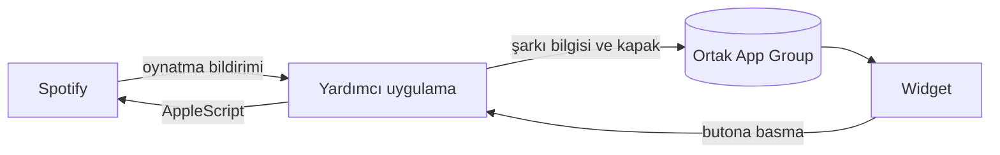

<div align="center">

# Spotify Widget

Spotify masaüstü uygulaması için yerel bir macOS widget'ı.<br>
Albüm kapağı, canlı ilerleme çubuğu ve oynatma kontrolleri masaüstünde ve Bildirim Merkezi'nde.

[](#kurulum)
[](#gereksinimler)
[](#diller)
[](LICENSE)

[English](README.md) · **Türkçe**


</div>

<!--
Demo kaydı:
<p align="center"></p>
-->

## Özellikler

- **Üç boyut.** Küçük, orta ve büyük; masaüstünde ya da Bildirim Merkezi'nde.
- **Oynatma kontrolleri.** Spotify'a geçmeden oynat, duraklat, önceki ve sonraki şarkı.
- **Canlı ilerleme.** Şarkı çaldıkça çubuk ve geçen süre ilerler.
- **Tıklayarak sarma.** Çubukta tıkladığın yere atlar.
- **Yerel görünüm.** Bulanık kapak arka planı ve sistem yazı tipleri. Albüm kapağı hiçbir zaman kırpılmaz.
- **16 dil.** Mac'inin diline kendiliğinden uyar.
- **Hafif.** Sürekli sorgulama yapmaz. Yalnızca Spotify bir değişiklik bildirdiğinde çalışır.
- **Gizli.** Spotify'ın görsel sunucularına giden kapak istekleri dışında Mac'inden hiçbir şey çıkmaz. Hesap, analiz ya da API anahtarı yok.

## Gereksinimler

| | En düşük | Test edilen |
|---|---|---|
| macOS | 14 Sonoma | 27.2 |
| Xcode (derlemek için) | 16 | 27.2 |
| Spotify | Masaüstü uygulaması | 1.3.6 |

- Spotify **web oynatıcısı desteklenmez**. Widget masaüstü uygulamasıyla konuşur.
- Derlenen uygulama universal'dır (Apple silicon ve Intel). Yalnızca Apple silicon'da test edildi.

## Kurulum

Uygulamayı kaynak koddan bir kez derliyorsun. Yaklaşık iki dakika sürer; Xcode ve ücretsiz bir Apple ID gerekir. `xcodebuild` Xcode gerektiğini söylerse önce `sudo xcode-select -s /Applications/Xcode.app` komutunu çalıştır.

### 1. Depoyu indir

```sh
git clone https://github.com/<kullanici-adin>/SpotifyWidget.git
cd SpotifyWidget
```

### 2. İmza bilgilerini ekle

Xcode'da Apple ID ile oturum aç (Xcode → Settings → Accounts). Sonra yerel ayar dosyasını oluştur:

```sh
cp Configs/Local.xcconfig.example Configs/Local.xcconfig
```

`Configs/Local.xcconfig` dosyasını açıp iki değeri de doldur:

| Anahtar | Değer |
|---|---|
| `DEVELOPMENT_TEAM` | Team ID'n. Xcode → Settings → Accounts → takımını seç. |
| `BUNDLE_ID_PREFIX` | Sana özgü herhangi bir şey, ör. `com.adin` |

`Local.xcconfig` git'e eklenmez, bilgilerin hiçbir commit'e girmez.

### 3. Derle

```sh
xcodebuild -project SpotifyWidget.xcodeproj -scheme SpotifyWidget \
  -configuration Release -destination 'generic/platform=macOS' \
  -derivedDataPath build -allowProvisioningUpdates build
```

### 4. Kur ve başlat

```sh
mkdir -p ~/Applications
cp -R "build/Build/Products/Release/Spotify Widget.app" ~/Applications/
open ~/Applications/"Spotify Widget.app"
```

Uygulamanın penceresi ve Dock simgesi yok. Arka planda çalışır ve oturum açtığında kendiliğinden başlar.

### 5. İzin ver

macOS, *Spotify Widget*'ın *Spotify*'ı denetlemesine izin verip vermeyeceğini sorar. **İzin Ver**'e tıkla.

### 6. Widget'ı ekle

Masaüstüne sağ tıkla ve **Widget'ları Düzenle**'yi seç. **Spotify** ara ve bir boyutu masaüstüne sürükle.

## Kaldırma

1. Widget'ı masaüstünden kaldır.
2. Yardımcı uygulamayı kapat ve sil:
   ```sh
   pkill -x "Spotify Widget"
   rm -rf /Applications/"Spotify Widget.app" ~/Applications/"Spotify Widget.app"
   ```
3. Hâlâ listede görünüyorsa *Spotify Widget*'ı Sistem Ayarları → Genel → Giriş Öğeleri'nden kaldır.

## Nasıl çalışır

Widget'lar sandbox içinde çalışır ve diğer uygulamaları denetleyemez. Bu yüzden proje iki parçadan oluşur.



**Yardımcı uygulama** (`SpotifyWidget/`)
- Spotify'ın `com.spotify.client.PlaybackStateChanged` bildirimini dinler. Şarkı bilgisi doğrudan bildirimden okunur.
- AppleScript'i yalnızca oynatma komutları için ve şarkı değişince kapak adresini almak için kullanır.
- Her kapağı bir kez indirir, önbelleğe alır ve küçük bulanık arka planı önceden hazırlar. Widget'ın hiçbir şeyi bulanıklaştırması gerekmez.

**Widget eklentisi** (`SpotifyWidgetExtension/`)
- Ortak durumu okur ve çizer.
- İlerleme çubuğu önceden hesaplanmış zaman çizelgesi kayıtlarıyla ilerler. Bunlar widget yenileme kotasından düşmez.
- Butonlar, yardımcı uygulamaya mesaj gönderen App Intent'lerdir.

### Performans

Apple silicon Mac'te Release sürümüyle ölçüldü:

| | |
|---|---|
| Spotify durumunu okuma | 1–12 ms |
| Oynat / duraklat | yaklaşık 20 ms |
| Sonraki şarkı, kapak indirme dahil | yaklaşık 110 ms |
| Boştayken CPU | %0 |
| Bellek (yardımcı uygulama) | yaklaşık 26 MB |

## Diller

Widget, Sistem Ayarları → Genel → Dil ve Bölge'deki dili kullanır. Dilin listede yoksa İngilizce görünür.

| | | | |
|---|---|---|---|
| English | Türkçe | Azərbaycanca | Қазақша |
| Кыргызча | Oʻzbekcha | Türkmençe | Deutsch |
| Español | Français | Italiano | Português (Brasil) |
| Русский | 日本語 | 한국어 | 简体中文 |

Çeviriler [`SpotifyWidgetExtension/Localizable.xcstrings`](SpotifyWidgetExtension/Localizable.xcstrings) ve [`SpotifyWidget/InfoPlist.xcstrings`](SpotifyWidget/InfoPlist.xcstrings) dosyalarında. Düzeltmeler ve yeni diller memnuniyetle karşılanır.

## Proje yapısı

```
Configs/                  Derleme ayarları
  Base.xcconfig           Sürüm ve ortak ayarlar
  Local.xcconfig.example  Team ID ve bundle öneki şablonu
Shared/                   Yardımcı uygulama ve widget'ın ortak kodu
SpotifyWidget/            Yardımcı uygulama
SpotifyWidgetExtension/   Widget eklentisi
Tests/                    Birim testleri
docs/images/              README görselleri
```

## Geliştirme

Testleri çalıştır:

```sh
xcodebuild test -project SpotifyWidget.xcodeproj -scheme SpotifyWidgetTests -destination 'platform=macOS'
```

Widget'ı kullanırken yardımcı uygulamanın süre loglarını izle:

```sh
log stream --level debug --predicate 'subsystem == "spotifywidget"'
```

Kendi uygulama ikonunu kullanmak için `SpotifyWidget/` klasörüne bir `AppIcon.icns` ve/veya içinde `AppIcon` bulunan derlenmiş bir `Assets.car` koy. İki dosya da git'e eklenmez.

## Sorun giderme

<details>
<summary>Widget galeride görünmüyor</summary>

Yardımcı uygulamanın çalıştığını `pgrep -l "Spotify Widget"` ile, uygulamanın `~/Applications` ya da `/Applications` içinde olduğunu kontrol et. Galeri eski bir ad ya da ikon gösteriyorsa oturumu kapatıp aç. Galeri uygulama bilgilerini önbellekte tutar.
</details>

<details>
<summary>Widget çalan bir şey yok diyor</summary>

Spotify masaüstü uygulamasında bir şarkı başlat. Widget yine güncellenmiyorsa Sistem Ayarları → Gizlilik ve Güvenlik → Otomasyon'u aç ve *Spotify Widget*'ın *Spotify*'ı denetleyebildiğini kontrol et.
</details>

<details>
<summary>İzin penceresinde "İzin Verme"ye bastım</summary>

İzni sıfırla ve uygulamayı yeniden aç:

```sh
tccutil reset AppleEvents "$(osascript -e 'id of app "Spotify Widget"')"
open -a "Spotify Widget"
```
</details>

<details>
<summary>Widget griye dönüyor</summary>

macOS, önünde bir pencere varken masaüstü widget'larını soluklaştırır. Masaüstünde boş bir yere tıkla, renkler geri gelir.
</details>

## Lisans

[MIT](LICENSE)
