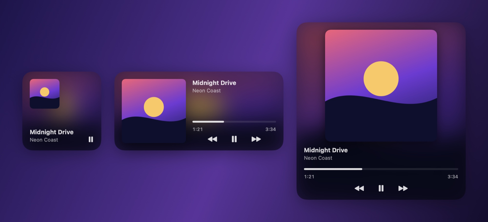
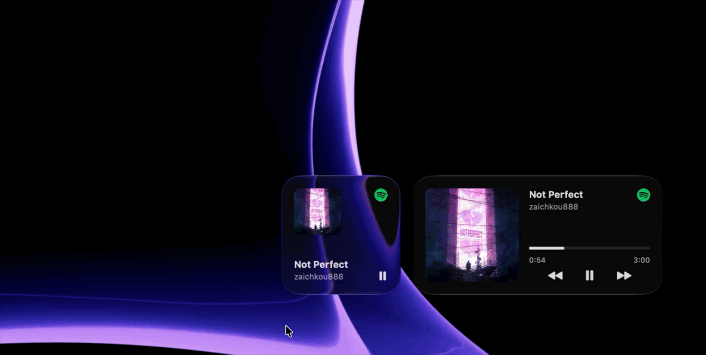
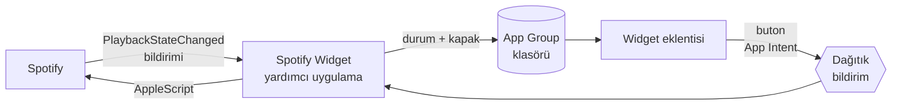

<div align="center">

# Spotify Widget

**Spotify uygulaması için yerel bir macOS masaüstü widget'ı.**
Albüm kapağı, canlı ilerleme çubuğu ve oynatma kontrolleri — masaüstünde ve Bildirim Merkezi'nde.

[](#değişiklik-günlüğü)
[](#gereksinimler)
[](#gereksinimler)
[](#gereksinimler)
[](#diller)
[](LICENSE)

[English](README.md) · **Türkçe**



</div>

<!--
Demo kaydı eklenince burada görünecek:
<p align="center"></p>
-->

## Özellikler

|  |  |
|---|---|
| 🎨 **Yerel görünüm** | Bulanık kapak arka planı, sistem yazı tipleri, açık ve koyu tema |
| 📐 **Üç boyut** | Küçük, orta ve büyük — masaüstüne ya da Bildirim Merkezi'ne sürükle |
| ⏯️ **Kontroller** | Oynat / duraklat, önceki ve sonraki şarkı doğrudan widget'tan |
| ⏱️ **Canlı ilerleme** | Şarkı çaldıkça ilerleyen çubuk, geçen ve toplam süre |
| 🎯 **Sarma** | Çubukta tıkladığın yere atlar |
| 🌍 **16 dil** | Mac'inin diline otomatik uyar |
| ⚡ **Hafif** | Boştayken ~%0 CPU, ~26 MB bellek, sürekli sorgulama yok |
| 🔒 **Gizli** | Her şey Mac'inde kalır — hesap yok, analiz yok, Spotify API anahtarı yok |

## Gereksinimler

| | En düşük | Test edilen |
|---|---|---|
| **macOS** | 14 Sonoma (etkileşimli widget'lar) | macOS 27.2 |
| **Xcode** | 16 (klasör senkronlu proje biçimi) | Xcode 27.2 |
| **Spotify** | Masaüstü uygulaması — web oynatıcı desteklenmez | 1.3.6 |
| **Apple ID** | Xcode'da oturum açılmış ücretsiz hesap | — |

Apple Silicon ve Intel Mac'lerin ikisi de desteklenir.

## Kurulum

> Henüz hazır indirme yok. Ücretsiz Apple ID ile imzalanan uygulamalar Apple onayından geçemediği için kendin derliyorsun — yaklaşık iki dakika sürer.

**1. Depoyu indir**

```sh
git clone https://github.com/<kullanici-adin>/SpotifyWidget.git
cd SpotifyWidget
```

**2. İmza bilgilerini ekle**

```sh
cp Configs/Local.xcconfig.example Configs/Local.xcconfig
```

`Configs/Local.xcconfig` dosyasını açıp doldur:

| Anahtar | Nerede bulunur |
|---|---|
| `DEVELOPMENT_TEAM` | Xcode → Settings → Accounts → takımını seç → *Team ID* |
| `BUNDLE_ID_PREFIX` | Sana özgü herhangi bir şey, ör. `com.adin` |

**3. Derle**

```sh
xcodebuild -project SpotifyWidget.xcodeproj -scheme SpotifyWidget \
  -configuration Release -derivedDataPath build -allowProvisioningUpdates build
```

Ya da `SpotifyWidget.xcodeproj` dosyasını Xcode'da açıp *Release* ayarıyla **⌘B**'ye bas.

**4. Kur ve başlat**

```sh
mkdir -p ~/Applications
cp -R "build/Build/Products/Release/Spotify Widget.app" ~/Applications/
open ~/Applications/"Spotify Widget.app"
```

Uygulamanın penceresi yok — arka planda sessizce çalışır ve kendini giriş öğelerine ekler.

**5. İzin ver**

macOS *Spotify Widget*'ın *Spotify*'ı denetlemesine izin verip vermeyeceğini sorduğunda **İzin Ver**'e tıkla.

**6. Widget'ı ekle**

Masaüstüne sağ tıkla → **Widget'ları Düzenle** → **Spotify** ara → istediğin boyutu masaüstüne sürükle.

## Nasıl çalışır

Widget'lar sandbox içinde çalışır ve diğer uygulamalarla konuşamaz. Bu yüzden proje iki parçadan oluşur:



- **Yardımcı uygulama** (`SpotifyWidget/`) Spotify'ın `com.spotify.client.PlaybackStateChanged` bildirimini dinler. Şarkı bilgisi doğrudan bildirimden okunur; AppleScript yalnızca kapak adresi ve oynatma komutları için kullanılır. Kapak şarkı başına bir kez indirilir, önbelleğe alınır ve küçük bulanık arka plan önceden hazırlanır.
- **Widget eklentisi** (`SpotifyWidgetExtension/`) ortak durumu okuyup çizer. İlerleme çubuğu önceden hesaplanmış zaman çizelgesiyle ilerler, hiçbir şeyi uyandırmaz. Butonlar, yardımcı uygulamaya bildirim gönderen App Intent'lerdir.

### Performans

Apple Silicon Mac'te Release sürümüyle ölçüldü:

| İşlem | Süre |
|---|---|
| Spotify durumunu okuma | 1–12 ms |
| Oynat / duraklat | ~21 ms |
| Sonraki şarkı (kapak indirme dahil) | ~110 ms |
| Boştayken CPU | %0 |
| Bellek (yardımcı uygulama) | ~26 MB |

## Diller

Widget Mac'inin diline uyar (Sistem Ayarları → Genel → Dil ve Bölge).

| | | | |
|---|---|---|---|
| 🇬🇧 English | 🇹🇷 Türkçe | 🇦🇿 Azərbaycanca | 🇰🇿 Қазақша |
| 🇰🇬 Кыргызча | 🇺🇿 Oʻzbekcha | 🇹🇲 Türkmençe | 🇩🇪 Deutsch |
| 🇪🇸 Español | 🇫🇷 Français | 🇮🇹 Italiano | 🇧🇷 Português (Brasil) |
| 🇷🇺 Русский | 🇯🇵 日本語 | 🇰🇷 한국어 | 🇨🇳 简体中文 |

Çeviriler [`SpotifyWidgetExtension/Localizable.xcstrings`](SpotifyWidgetExtension/Localizable.xcstrings) ve [`SpotifyWidget/InfoPlist.xcstrings`](SpotifyWidget/InfoPlist.xcstrings) dosyalarında. Düzeltmeler ve yeni diller memnuniyetle karşılanır.

## Proje yapısı

```
SpotifyWidget/
├── Configs/                    Derleme ayarları (.xcconfig)
│   ├── Base.xcconfig           Ortak ayarlar, sürüm, Debug/Release
│   ├── SpotifyWidget.xcconfig
│   ├── SpotifyWidgetExtension.xcconfig
│   ├── SpotifyWidgetTests.xcconfig
│   └── Local.xcconfig.example  Takım kimliğin ve bundle öneki
├── Shared/                     İki hedefin ortak kodu
├── SpotifyWidget/              Arka plan yardımcı uygulaması
├── SpotifyWidgetExtension/     WidgetKit eklentisi
│   └── Views/
├── Tests/                      Birim testleri (Swift Testing)
└── docs/images/                README görselleri
```

## Testler

```sh
xcodebuild test -project SpotifyWidget.xcodeproj -scheme SpotifyWidgetTests -destination 'platform=macOS'
```

## Sorun giderme

<details>
<summary><b>Widget galeride görünmüyor</b></summary>

Uygulamanın çalıştığından (`pgrep -l "Spotify Widget"`) ve `~/Applications` ya da `/Applications` içinden açıldığından emin ol. Galeri hâlâ eski ad ya da ikonu gösteriyorsa oturumu kapatıp aç — galeri uygulama bilgilerini önbellekte tutar.
</details>

<details>
<summary><b>Widget çalan bir şey yok diyor</b></summary>

Spotify masaüstü uygulamasında bir şarkı başlat. Yine güncellenmiyorsa Sistem Ayarları → Gizlilik ve Güvenlik → Otomasyon'da *Spotify Widget*'ın *Spotify*'ı denetlemesine izin verildiğini kontrol et.
</details>

<details>
<summary><b>İzin penceresinde "İzin Verme"ye bastım</b></summary>

İzni sıfırla ve uygulamayı yeniden başlat:

```sh
tccutil reset AppleEvents <bundle-onekin>.spotifyhelper
```
</details>

<details>
<summary><b>Widget gri / kapaksız görünüyor</b></summary>

macOS, önünde bir pencere varken masaüstü widget'larını soluklaştırır. Masaüstünde boş bir yere tıkla, renkli hâli geri gelir.
</details>

## Özel ikon

`SpotifyWidget/` klasörüne `Assets.car` (içinde `AppIcon` olan derlenmiş ikon) ve/veya `AppIcon.icns` koyarsan otomatik kullanılır. İkisi de git'e eklenmez.

## Değişiklik günlüğü

**1.1**
- Şarkı bilgisi doğrudan Spotify bildirimlerinden okunuyor — 10 kata kadar daha hızlı güncelleme
- Tıklanabilir ilerleme çubuğu, geçen ve toplam süre
- Azerice, Kazakça, Kırgızca, Özbekçe ve Türkmence dahil 16 dil
- Büyük boyutta kırpılmamış kare kapak
- Birim testleri

**1.0**
- İlk sürüm

## Sorumluluk reddi

Bu proje Spotify ile bağlantılı değildir, Spotify tarafından onaylanmamış ya da desteklenmemiştir. Spotify, Spotify AB'nin ticari markasıdır.

## Lisans

[MIT](LICENSE)
